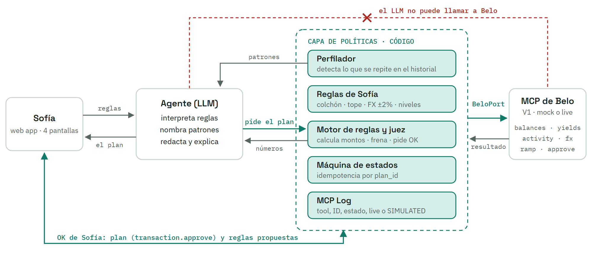

# CFO Agéntico

**El CFO que se gana tu confianza.**

Para quien recibe dinero en una moneda y paga en otra (freelancers, migrantes, familias entre países o pequeños negocios), cada ingreso trae la misma pregunta: ¿cuánto cambio, a qué moneda, cuándo y qué aparto? **CFO Agéntico** es un mini CFO dentro de Belo que aprende a responderla. Durante sus primeras semanas observa en modo sombra: perfila los movimientos de la persona, descubre sus obligaciones recurrentes y el ritmo de sus ingresos, y le propone reglas para que las confirme. Desde entonces, cada vez que entra dinero, un motor de reglas arma el plan: cambia solo lo necesario para cubrir los pagos que se aproximan, en la moneda de cada pago, protege el excedente en dólares digitales con rendimiento y aparta los impuestos. El agente explica cada decisión en lenguaje simple; nada se mueve sin el OK de la persona, y cada operación queda registrada y protegida contra errores y duplicados. Con el tiempo, se gana el permiso para encargarse solo de lo rutinario.

> Proyecto de **Dev IngenierIA** para el **Reto 1 · Banca agéntica (Belo)** del Hackathon 30X, del 27 al 29 de noviembre de 2026.
>
> **Estado:** especificación y estructura listas. El código se escribe durante el hackathon.

---

## El problema

Muchas personas en Latinoamérica cobran en una moneda y pagan en otra. Sin un plan, una devaluación las encuentra con todo el dinero en la moneda equivocada, y decidir cada semana cuánto cambiar, cuándo y qué apartar es estresante. Por eso mucha gente usa Belo de **"pasamanos"**: le entra el dinero y lo saca al banco a los dos días.

Belo nombró dos dolores que queremos resolver:
1. **El pasamanos:** el dinero entra y se va, en lugar de quedarse en Belo.
2. **La confianza:** no hay referentes de cómo confiarle el dinero a un agente.

## Cómo lo resolvemos

Primero aprende de los movimientos de la persona y le propone reglas. Después, cuando entra un pago, arma un plan, lo explica en lenguaje simple y lo ejecuta solo con su aprobación.

| Principio | Qué significa |
|---|---|
| **Aprende de tus movimientos** | En modo sombra, un perfilador (código) detecta lo que se repite en el historial: obligaciones, ingresos, retiros. El LLM lo interpreta ("esto es tu alquiler") y lo propone como regla. Nada se aplica sin confirmación. |
| **La IA propone y explica** | El LLM interpreta reglas dichas en lenguaje natural, redacta el plan y explica qué, por qué y con cuánto dinero. No calcula montos ni mueve fondos. |
| **El código frena** | Colchón, topes, tolerancia de FX e idempotencia viven en código. Si alguien intenta una excepción, el motor la bloquea aunque el modelo "quiera" autorizarla. |
| **La persona aprueba** | Ningún movimiento sale sin un OK explícito: aprueba el plan en CFO Agéntico y cada movimiento real en el link de Belo, con el código que le llega por correo. |
| **La autonomía se gana** | Cada tipo de movimiento empieza pidiendo permiso. Con evidencia, el agente pide hacer solo lo rutinario; con un reverso, pierde ese permiso. |
| **Transparencia total** | Cada paso queda en un MCP Log con la tool, el ID y el estado. Lo que no corre en vivo lleva el badge **SIMULATED**. |

### Ejemplo: Sofía (datos sintéticos)

Sofía es diseñadora freelance en Buenos Aires. Cobra USD 1.500 de un cliente en EE. UU. y el jueves paga 450.000 ARS de alquiler. Ese vencimiento no lo cargó a mano: el agente lo encontró en su historial ("todos los meses pagas 450.000 ARS a Inmobiliaria Palermo, ¿es tu alquiler?") y ella lo confirmó. Sus reglas: nunca bajar de USD 500 en dólares, no cambiar más de USD 400 a pesos sin preguntar y frenar si el dólar se mueve más de 2%.

Cuando entra el pago, el plan es:

| Movimiento | Monto | Por qué |
|---|---|---|
| Dejar rindiendo en USDT | USD 900 | Es el excedente; el rendimiento es variable, no garantizado |
| Apartar en la alcancía "Impuestos" | USD 120 | 8% del ingreso; cubre el monotributo del día 20 |
| Cambiar a pesos el jueves | USD 380 → 450.300 ARS | Solo lo que vence, a 1.185 ARS por dólar |
| Libre | USD 100 | Para el día a día |

En dólares quedan **USD 1.120**, así que el colchón está cubierto. Si el jueves el dólar empeoró más de 2%, la conversión se retiene y vuelve a preguntar. Si antes del jueves mejora 2% o más, el agente propone adelantarla gastando menos dólares.

El ejemplo usa dólares y pesos argentinos, pero el flujo es genérico: cada obligación se convierte a la moneda en que vence (ARS, BRL, COP, CLP o MXN).

## La demo en 50 segundos

| Pantalla | Qué se ve |
|---|---|
| 1 · Reglas | Las reglas de Sofía, editables. El control lo pone la persona, no el modelo. |
| 2 · Plan del ingreso | Entra un pago y aparece la tarjeta con los 3 movimientos y su explicación. |
| 3 · Caso Rojo + aprobación | Sofía pide cambiar USD 1.100 a pesos y el motor lo bloquea, porque le quedarían USD 400 en dólares. Luego aprueba el plan válido y se ven los estados: propuesto → aprobado → ejecutando → completado. |
| 4 · Resumen y MCP Log | Qué se hizo, por qué y con cuánto dinero, y cada tool del MCP con su ID y estado. |

## Arquitectura



- **Arquitectura hexagonal:** todo acceso a Belo pasa por el puerto `BeloPort`, con dos adaptadores: `MockBeloAdapter` (desde el inicio) y `LiveBeloMCPAdapter` (con el kit oficial). Cambiar de uno a otro no toca la lógica de negocio.
- **El motor de reglas calcula y el juez decide** ejecutar, pedir aprobación o bloquear. El LLM solo redacta.
- **Máquina de estados con idempotencia:** la misma aprobación nunca ejecuta dos veces, y un timeout se reconcilia con `account.activity` en vez de reintentar a ciegas.

Detalle completo en [`docs/arquitectura.md`](docs/arquitectura.md).

### Qué usamos del MCP de Belo

El MCP está en `https://b2b.belo.app/mcp` (HTTP con OAuth). Cada operación que mueve dinero se aprueba en un link de Belo con un código que llega por correo.

| Capacidad del MCP | Uso en CFO Agéntico | En vivo o simulado |
|---|---|---|
| Consultar saldos | Verificar el colchón y armar el plan | En vivo desde el portátil; mock en la URL pública |
| Consultar movimientos | Detectar ingresos, perfilar el historial y reconciliar | En vivo desde el portátil; mock en la URL pública |
| Convertir monedas | USD→USDT y USD→ARS | Un movimiento real de monto chico en la demo; el resto, mock |
| Transferir a CBU, CVU o alias | Pagar el alquiler | Mock en la demo (posible en vivo) |
| Link de aprobación con código | El OK final de cada movimiento | Belo, en vivo |
| Alcancías | Apartar impuestos | **SIMULATED** (el MCP solo permite consultarlas) |

Los nombres exactos de las tools y sus parámetros se documentan en `docs/belo-mcp/` cuando los obtengamos. Detalle en [`docs/ruta-de-trabajo.md`](docs/ruta-de-trabajo.md#el-mcp-de-belo).

## Stack

| Capa | Tecnología |
|---|---|
| Backend y agente | Python, FastAPI, LangGraph (o máquina de estados en Python puro) |
| Frontend | React + TypeScript |
| Datos | SQLite |
| Integración | MCP V1 de Belo detrás de `BeloPort` |
| Despliegue | Docker Compose en un droplet de DigitalOcean, con Caddy (HTTPS), dominio en Cloudflare y GitHub Actions |

Detalle de cada elección, quién hace qué y el plan hora a hora en [`docs/ruta-de-trabajo.md`](docs/ruta-de-trabajo.md).

## Estructura del repositorio

```
cfo-agentico/
├── README.md
├── CONTRIBUTING.md          Cómo trabajamos: ramas, commits y reglas del código
├── .env.example             Variables de entorno (sin secretos)
├── docs/
│   ├── arquitectura.md      Piezas, estados, autonomía, juez y disparadores
│   ├── caso-de-prueba.md    Especificación de punta a punta con Sofía y los 12 casos de seguridad
│   ├── decisiones.md        Decisiones tomadas, pendientes y preguntas para Belo
│   ├── ruta-de-trabajo.md   Tecnologías, despliegue, roles, ramas y plan por bloques
│   └── diagramas/           Imágenes de la arquitectura, los estados y la autonomía
├── data/
│   ├── sofia-demo.json      Reglas y saldos sintéticos de la demo
│   └── historial-sofia.json 6 meses de movimientos sintéticos para el perfilado
├── backend/                 Python + FastAPI (arquitectura hexagonal)
│   ├── app/
│   │   ├── domain/          Perfilador, motor de reglas, juez, estados y autonomía (sin I/O)
│   │   ├── ports/           BeloPort
│   │   ├── adapters/        MockBeloAdapter y LiveBeloMCPAdapter
│   │   ├── agent/           Grafo del agente y prompts
│   │   ├── api/             Endpoints para el frontend
│   │   └── db/              Esquema SQLite
│   └── tests/               Casos de seguridad T01–T12
└── frontend/                React + TypeScript (las 4 pantallas)
```

Cada carpeta tiene un `README.md` con su responsabilidad y lo que se va a construir ahí.

## Cómo correrlo

**Demo en línea:** _enlace pendiente; se publica el viernes 27 por la noche y se actualiza con cada merge a `main`._ En la versión pública todo lo que mueve dinero corre contra el mock (SIMULATED), y el botón **Reiniciar demo** vuelve al estado inicial.

> Se completa durante el hackathon. El flujo previsto es:

```bash
cp .env.example .env

# Backend
cd backend
uv sync
uv run pytest                              # los 12 casos de seguridad
uv run uvicorn app.api.main:app --reload

# Frontend
cd ../frontend
npm install
npm run dev
```

Por defecto corre contra el mock (`BELO_ADAPTER=mock`), así que no hace falta acceso al MCP para probarlo.

## Qué es simulado

- **Los datos de Sofía son sintéticos**, incluido su historial de movimientos. El proyecto no usa datos reales de ninguna persona.
- **Las alcancías y el pago de servicios** no están en la V1 del MCP: se ejecutan contra el mock con el badge SIMULATED.
- **Cualquier operación que la V1 no permita** para un par de monedas cae al mock y se marca como SIMULATED. Nunca se finge una operación en vivo.

## Casos de seguridad

Doce pruebas escritas antes de la interfaz. Entre otras: un patrón detectado no se aplica sin confirmación, el colchón nunca se rompe, un doble clic no ejecuta dos veces, un timeout no duplica la operación, un prompt injection no genera movimientos y la conversión se retiene si el dólar empeora más de 2%. La lista completa está en [`backend/tests/README.md`](backend/tests/README.md).

## Hacia dónde puede crecer

- Cobros entrantes automáticos desde Upwork, Deel o Payoneer.
- Pago real de servicios y monotributo cuando estén disponibles en el MCP.
- Otros corredores, por ejemplo cobrar en reales y pagar en Colombia.
- Un segundo OK familiar para remesas o finanzas compartidas.

## Equipo · Dev IngenierIA

| Integrante | Rol |
|---|---|
| Julia Arizbeth Gómez Gámez | Producto, documentación y pitch |
| Cesar David Revelo Apraez | AI/ML y orquestación |
| Vanessa Yareli Hernández Cázares | Validaciones y datos |
| Juan Carlos Pastas Valencia | Backend y despliegue |
| Brigitte Aponte | Frontend |
