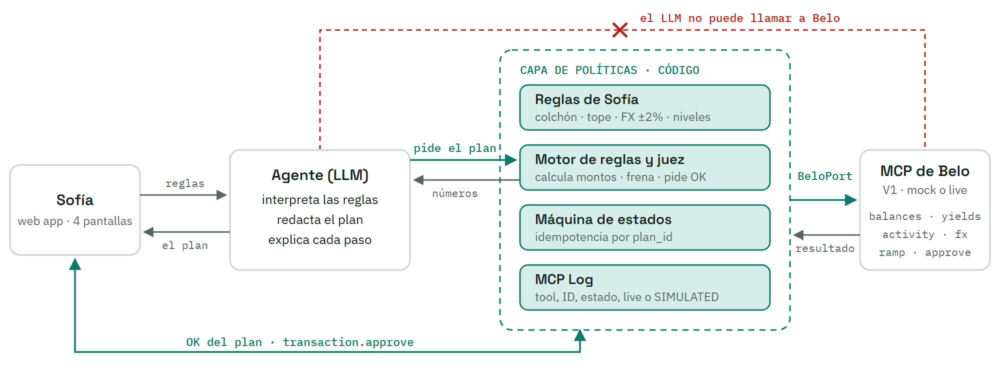
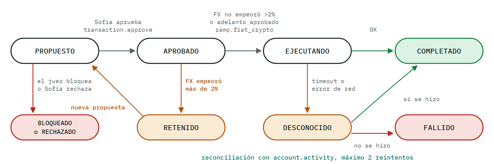
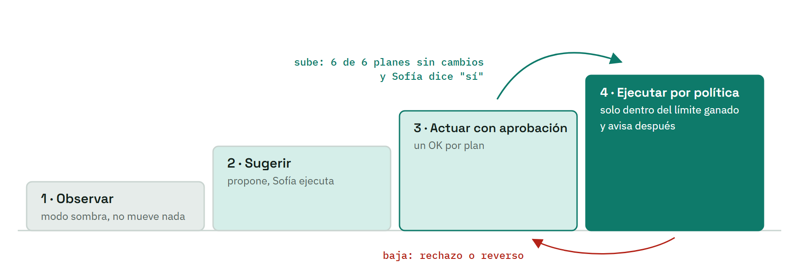

# Arquitectura

CFO Agéntico separa tres responsabilidades: **la IA propone, el código frena y la persona aprueba.** Esta página resume las piezas, los estados, la escalera de autonomía, cómo decide el juez y cuándo actúa el agente. El recorrido completo con montos está en [`caso-de-prueba.md`](caso-de-prueba.md).

## 1. Las piezas del sistema

| Pieza | Responsabilidad | ¿Usa LLM? |
|---|---|---|
| **Frontend** (4 pantallas) | Reglas, plan, aprobación, resumen y MCP Log | No |
| **Agente** | Interpreta reglas en lenguaje natural, redacta el plan y explica cada paso | Sí |
| **Reglas de la persona** | Colchón, tope, tolerancia de FX, impuestos y niveles de autonomía, guardados en la base de datos | No |
| **Motor de reglas y juez** | Calcula los montos del plan y decide ejecutar, pedir aprobación o bloquear | No |
| **Máquina de estados** | Estados de cada movimiento con idempotencia por `plan_id` + paso | No |
| **MCP Log** | Registro de cada tool llamada, con ID, estado y si fue en vivo o simulada | No |
| **BeloPort** | Puerto único hacia Belo, con dos adaptadores: mock y MCP V1 en vivo | No |

**El LLM no tiene tools de escritura.** Aunque se lo engañe, no tiene con qué mover dinero: toda escritura pasa por el juez y por `BeloPort`.

## 2. Estados de cada movimiento

| Desde | Hacia | Cuándo |
|---|---|---|
| PROPUESTO | APROBADO | La persona aprueba (`transaction.approve`) o hay política de nivel 4 |
| PROPUESTO | BLOQUEADO / RECHAZADO | El juez bloquea o la persona rechaza |
| APROBADO | EJECUTANDO | El FX no empeoró más de 2%, o se aprobó un adelanto |
| APROBADO | RETENIDO | Al ejecutar, el FX empeoró más de 2% |
| RETENIDO | PROPUESTO | Se arma una nueva propuesta con la cotización actual |
| EJECUTANDO | COMPLETADO | Belo confirma |
| EJECUTANDO | DESCONOCIDO | Timeout o error de red |
| DESCONOCIDO | COMPLETADO / FALLIDO | Reconciliación con `account.activity`, máximo 2 reintentos |

Cualquier transición que no esté en esta tabla se rechaza en el backend.

## 3. Escalera de autonomía

| Nivel | Nombre | Qué hace el agente |
|---|---|---|
| 1 | Observar | Modo sombra: registra lo que habría hecho y su resultado, a favor o en contra |
| 2 | Sugerir | Propone, pero la persona ejecuta |
| 3 | Actuar con aprobación | Un OK por plan |
| 4 | Ejecutar por política | Ejecuta solo dentro del límite ganado y avisa después |

Cada categoría tiene su propio nivel: `rendimiento_usdt`, `apartar_impuestos`, `convertir_para_vencimientos`, `adelantar_conversion_favorable` y `salidas_a_terceros`.

- **Sube** cuando hay evidencia (por ejemplo, 6 planes aprobados sin cambios ni reversos) y la persona acepta.
- **Baja** un nivel con un solo rechazo o reverso.
- Se empieza por lo de menos riesgo, lo que no sale de dólares. **Cambiar a pesos sigue pidiendo OK.**

## 4. Cómo decide el juez

Los chequeos van en este orden y el primero que aplica decide:

1. **¿Este movimiento ya se evaluó?** → devuelve el mismo resultado (idempotencia).
2. **¿Pausa global activa?** → BLOQUEAR.
3. **¿Moneda fuera de USD, USDT, USDC o ARS?** → BLOQUEAR.
4. **¿En dólares quedaría menos de USD 500?** → BLOQUEAR. El colchón suma cuenta USD + USDT + alcancías; cambiar a pesos lo reduce y mover entre bolsas en dólares no.
5. **¿Es una salida a terceros?** → BLOQUEAR (no hay tool en la V1 y la categoría está en nivel 1).
6. **¿Categoría en nivel 1 o 2?** → SOMBRA o SUGERIR.
7. **¿Cambio a pesos mayor de USD 400?** → pide un OK ADICIONAL.
8. **¿Nivel 4 y dentro del límite ganado?** → EJECUTAR.
9. **Cualquier otro caso** → PEDIR APROBACIÓN, dentro del plan del ingreso.

Además:
- **Antes del vencimiento, cada hora:** si el dólar mejoró 2% o más, propone adelantar la conversión con menos USD. Solo aplica a dinero que ya tiene un vencimiento asignado.
- **Al ejecutar:** si el dólar empeoró más de 2%, RETENER. Si no, cambia solo lo necesario, nunca más de lo aprobado.

## 5. Cuándo actúa el agente

| Disparador | Cómo se detecta | Qué hace |
|---|---|---|
| **Entra un pago** (principal) | Ingreso nuevo en `account.activity` | Arma el plan de ese ingreso y pide un OK |
| **El dólar mejora antes de un vencimiento** | `exchange.fx` cada hora | Propone adelantar la conversión |
| **Vence una conversión programada** | Fecha del vencimiento | Revisa la tolerancia de FX y ejecuta o retiene |
| **Resumen semanal** | Calendario, los lunes | Informa qué entró, qué se hizo y qué viene; no mueve dinero |

Los ingresos menores a USD 100 no disparan un plan: se acumulan para el siguiente, para no llenar a la persona de aprobaciones.

## 6. Grafo del agente

| Nodo | Qué hace | ¿Usa LLM? |
|---|---|---|
| `load_context` | Carga perfil, reglas y vencimientos | No |
| `fetch_belo` | Saldos, rendimientos, movimientos y FX vía `BeloPort` | No |
| `rules_engine` | Calcula el plan y corre el juez | No |
| `compose_plan` | Redacta la tarjeta y el "por qué" | Sí |
| `human_approval` | `interrupt()` → `transaction.approve` | No |
| `execute_and_audit` | Ejecuta, aplica estados e idempotencia, escribe el MCP Log | No |

El grafo orquesta, pero las transiciones de estado las valida el dominio. Así hay una sola fuente de verdad sobre el dinero.
